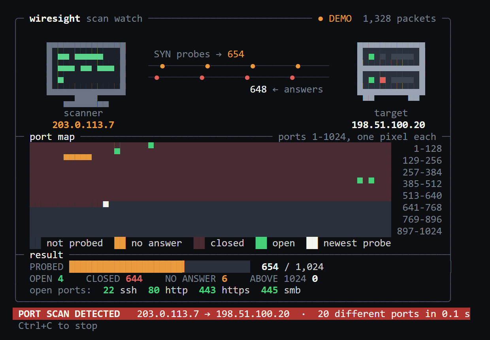
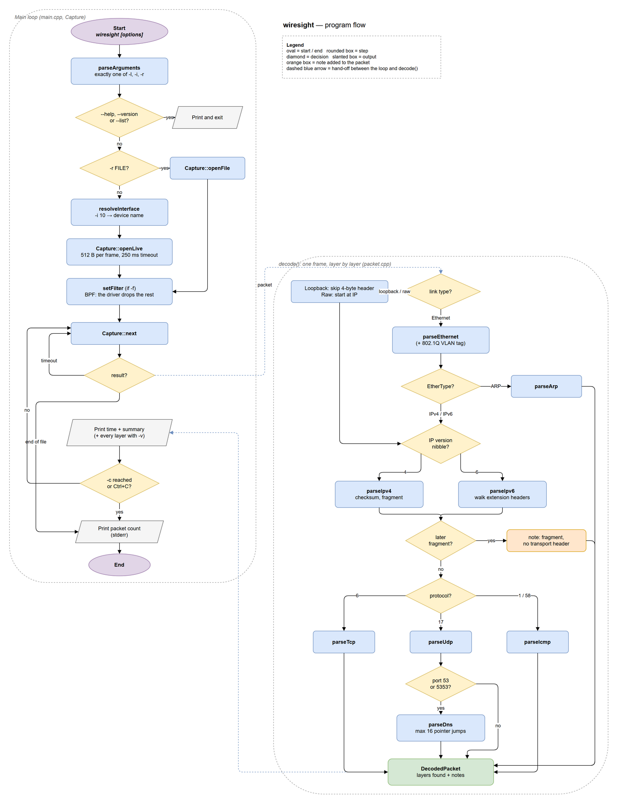
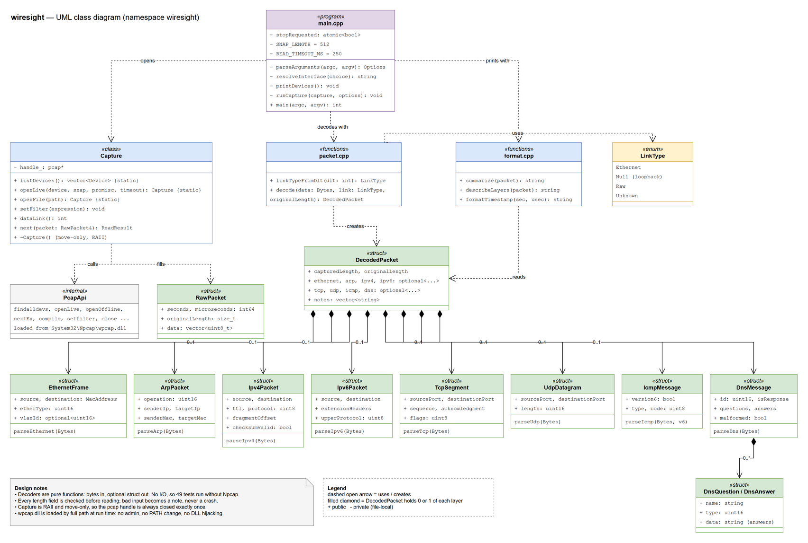

# wiresight

A packet sniffer and protocol analyzer in C++20: it captures live network traffic and decodes Ethernet, ARP, IPv4, IPv6, TCP, UDP, ICMP and DNS byte by byte, to show what tools like Wireshark do underneath.

> Only capture on networks you own or have permission to monitor. Capturing other people's traffic without permission can be illegal.

## Overview

### What

A command-line tool that opens a network interface (or a saved `.pcap` file), reads every frame, decodes each protocol layer from the raw bytes, and prints one readable line per packet:

```
17:26:48.401673  TCP   127.0.0.1:62530 -> 127.0.0.1:9  [SYN] seq=1602619756 len=0
17:26:48.401688  TCP   127.0.0.1:9 -> 127.0.0.1:62530  [RST, ACK] seq=0 ack=1602619757 len=0
```

It also **spots port scans** as they happen. With `--watch` it draws them as pixel art in the terminal: the scanner, the target, packets moving along the wire, and a map of ports 1 to 1024 filling up as they are probed.



### Problem

Everything on a network, a web page, a DNS lookup, a port scan, an attack, is just bytes on a wire. When something breaks or looks suspicious, the only ground truth is **what the packets actually say**:

- **Network engineering:** why does this connection fail? Is the handshake completing? Is DNS answering, and with what?
- **Security:** which hosts is this machine talking to? Is something scanning the network (lots of SYNs and RSTs)? Is someone forging ARP replies to intercept traffic?

Wireshark answers this, but it hides the hard part: turning raw bytes into fields. Packet decoders also read data from strangers, which makes them a classic source of security bugs: Wireshark itself has had many crashes and vulnerabilities in its protocol decoders.

### Solution

- **Live capture through Npcap/libpcap**, with optional BPF filters (`tcp port 445`) so the kernel driver drops unwanted packets before they are copied.
- **Hand-written decoders for each layer**, reading big-endian fields from a `std::span` of bytes, with every length field checked before it is trusted.
- **Defensive DNS parsing:** compressed names are followed with a cap of 16 pointer jumps and 255 bytes, so a crafted packet that points at itself cannot hang the program.
- **Port scan detection:** one address sending SYNs to 20 or more different ports of one target within 10 seconds raises an alarm. Counting *different ports*, not connections, keeps a browser opening dozens of connections to port 443 quiet.
- **Safe-by-design capture:** only the first 512 bytes of each frame are kept, nothing is written to disk, and on Windows the capture library is loaded by its full path to avoid DLL hijacking.

### Why I built it

Wireshark already exists. wiresight exists to understand **how packet analysis works underneath** and to practise writing C++ that safely handles untrusted input:

| Concept | Where it lives |
|---|---|
| Ethernet frames, VLAN tags, ARP | `ethernet.cpp`, `arp.cpp` |
| IPv4 header, checksums, fragmentation | `ipv4.cpp` |
| IPv6 and extension headers | `ipv6.cpp` |
| TCP handshake and flags, UDP, ICMP | `tcp.cpp`, `udp.cpp`, `icmp.cpp` |
| DNS wire format and name compression | `dns.cpp` |
| Byte order, `std::span`, `std::optional` | `bytes.hpp` and every decoder |
| RAII, move-only resource handles | `Capture` in `capture.cpp` |
| Loading a DLL safely at run time | `pcapApi()` in `capture.cpp` |
| Detecting a port scan in a sliding window | `scan.cpp` |
| Pixel art in a terminal: half blocks and 24-bit colour | `watch.cpp` |
| Testing hostile input | 64 tests, including every possible truncation of real packets |

### Part of a project series

Each project looks at the same network from a different side:

| Project | Language | View | Question it answers |
|---|---|---|---|
| [**portscout**](https://github.com/AoceanP/portscout) | Java 21 | the attacker's view | What ports are open, and what is running behind them? |
| **wiresight** (this one) | C++20 | the network's view | What is actually on the wire? |
| [**logonwatch**](https://github.com/AoceanP/logonwatch) | C# / .NET 10 | the defender's view | Is someone trying to break in, and did they get in? |
| [**tracekeep**](https://github.com/AoceanP/tracekeep) | Python | the evidence's view | Can the logs still be trusted afterwards? |

They work together: **portscout sends the probes, wiresight shows the packets**. Run wiresight on the loopback adapter while portscout scans, and you can watch a closed port answer `SYN` with `RST`, an open one complete the three-way handshake, and portscout's 19-byte banner probe; see [Example: watching portscout](#example-watching-portscout) below.

## Setup

### 1. Install the requirements

| | Windows | Linux |
|---|---|---|
| Compiler | GCC 13+ (MinGW, bundled with CLion) or Visual Studio 2022 | GCC 13+ or Clang 17+ |
| Build tool | CMake 3.20+ (bundled with CLion) | CMake 3.20+ |
| Capture driver | [Npcap](https://npcap.com/#download) (installed with Wireshark) | `libpcap` |
| Headers | [Npcap SDK](https://npcap.com/#download), unzipped anywhere | `sudo apt install libpcap-dev` |

Without the Npcap SDK or libpcap, only the tests are built; that is enough to check the decoders.

### 2. Get the code

```
git clone https://github.com/AoceanP/wiresight.git
cd wiresight
```

### 3. Build

**CLion:** open the folder, then in *Settings → Build → CMake* add `-DNPCAP_SDK_DIR=C:/path/to/npcap-sdk` to the CMake options, and build.

**Command line:**

```
cmake -S . -B build -DNPCAP_SDK_DIR=C:/path/to/npcap-sdk
cmake --build build
```

On Linux, leave out `-DNPCAP_SDK_DIR`. You can also set an `NPCAP_SDK` environment variable instead of passing the option.

### 4. Run the tests

```
build/wiresight_tests
```

It ends with `64 of 64 tests passed`.

### 5. Capture

```
build/wiresight --list
build/wiresight -i 6
```

Pick the interface number from `--list`. On Windows, Npcap lets normal users capture unless it was installed in admin-only mode; on Linux, run with `sudo` or give the program the `cap_net_raw` capability.

### Troubleshooting

- **The program exits with no output at all (exit code `-1073741515`, `0xC0000135`):** Windows could not find `libwinpthread-1.dll`, a MinGW runtime file. The build copies it next to `wiresight.exe`; if you moved the program, move the DLL with it.
- **`Npcap is not installed`:** install Npcap from npcap.com, or Wireshark, which includes it.
- **`Npcap SDK not found, so only the tests are built`:** the SDK path is wrong; it must be the folder that contains `Include/pcap.h`.
- **No packets on loopback:** pick the interface named *Adapter for loopback traffic capture*; Npcap must have been installed with loopback support.
- **`IPv4 checksum mismatch` on your own packets:** normal. Network cards fill in checksums after capture (checksum offload).

## Usage

```
wiresight [options]
```

| Option | Meaning |
|---|---|
| `-l, --list` | list the interfaces you can capture on |
| `-i, --interface N` | capture live on interface number `N` from `--list` (or its name) |
| `-r, --read FILE` | decode a saved `.pcap` file instead |
| `-f, --filter EXPR` | capture filter, e.g. `"tcp port 445"`, `"udp port 53"`, `"arp"` |
| `-c, --count N` | stop after `N` packets |
| `-v, --verbose` | show every layer of each packet |
| `-p, --promiscuous` | also capture traffic for other machines on the network |
| `-w, --watch` | show the scan watch (pixel art) instead of packet lines |
| `--demo` | play a built-in port scan in the scan watch: no capture, no admin rights |
| `--scan-threshold N` | different ports from one address within 10 s that count as a scan (default 20) |
| `--version` | show the version and the capture library |

Packets go to standard output and status lines to standard error, so the output can be piped to `grep` or a file. Press Ctrl+C to stop.

### Scan watch: see a port scan

Try it with no setup at all:

```
wiresight --demo
```

This plays a made-up scan through the real decoder and detector. First comes a second of normal browsing, which raises no alarm. Then 203.0.113.7 scans ports 1 to 1024 of 198.51.100.20 the way portscout does. (Both addresses are reserved for documentation, so nothing real is involved.)

How to read the screen:

| Part | What it shows |
|---|---|
| **The wire** | amber dots are SYN probes going to the target; dots coming back are its answers, green for "open" (SYN-ACK) and red for "closed" (RST) |
| **The server's LEDs** | top: power, and amber blinking while it is being probed. Bottom: green once an open port is found, and red blinking when the alarm is raised |
| **The port map** | one pixel per port, 1 to 1024, left to right and top to bottom like reading a page. Dark: not probed. Amber: probed, no answer (a firewall dropping it shows up as amber that never changes). Dark red: closed. Green: open. White: the newest probe |
| **The counts** | probed, open, closed and unanswered ports, with the open ones named (22 ssh, 443 https) |
| **The banner** | green "no scan detected" until one address probes 20 different ports within 10 s, then the red **PORT SCAN** alarm |

To watch a real scan, capture the loopback adapter and scan yourself with portscout:

```
wiresight -i 10 --watch
portscout 127.0.0.1 -p 1-1024
```

Without `--watch`, scans are still detected: a line appears among the packets.

```
!!  PORT SCAN  127.0.0.1 -> 127.0.0.1: 20 ports in 0.71 s
```

The view needs a terminal with 24-bit colour, 80 columns wide: Windows Terminal, the Windows 10/11 console, and every common macOS and Linux terminal.

### Example: watching portscout

Capture the loopback adapter while portscout probes a closed port (9) and an open one (445):

```
wiresight -i 10 -f "tcp port 445 or tcp port 9"
portscout 127.0.0.1 -p 9,445
```

```
17:26:48.401670  TCP   127.0.0.1:62529 -> 127.0.0.1:445  [SYN] seq=2856850300 len=0
17:26:48.401673  TCP   127.0.0.1:62530 -> 127.0.0.1:9  [SYN] seq=1602619756 len=0
17:26:48.401688  TCP   127.0.0.1:9 -> 127.0.0.1:62530  [RST, ACK] seq=0 ack=1602619757 len=0
17:26:48.401749  TCP   127.0.0.1:445 -> 127.0.0.1:62529  [SYN, ACK] seq=2516777520 ack=2856850301 len=0
17:26:48.401763  TCP   127.0.0.1:62529 -> 127.0.0.1:445  [ACK] seq=2856850301 ack=2516777521 len=0
17:26:48.906665  TCP   127.0.0.1:62529 -> 127.0.0.1:445  [PSH, ACK] seq=2856850301 ack=2516777521 len=19
17:26:48.906690  TCP   127.0.0.1:445 -> 127.0.0.1:62529  [ACK] seq=2516777521 ack=2856850320 len=0
17:26:48.906715  TCP   127.0.0.1:445 -> 127.0.0.1:62529  [RST, ACK] seq=2516777521 ack=2856850320 len=0
```

- **Port 9 is closed:** the SYN gets a `RST, ACK` back straight away.
- **Port 445 is open:** `SYN`, `SYN, ACK`, `ACK`, the three-way handshake.
- **Half a second later** portscout sends its 19-byte banner probe (`HEAD / HTTP/1.0\r\n\r\n` is exactly 19 bytes), and Windows file sharing, which does not speak HTTP, resets the connection.

### Example: one packet in verbose mode

```
16:00:01.250000  ARP   who has 192.168.1.1? tell 192.168.1.5
    Ethernet  66:77:88:99:aa:bb -> ff:ff:ff:ff:ff:ff  type 0x0806
    ARP       who has 192.168.1.1? tell 192.168.1.5  sender 66:77:88:99:aa:bb 192.168.1.5  target 00:00:00:00:00:00 192.168.1.1
```

## Privacy and data

Packets can contain passwords, messages and browsing history, so wiresight keeps as little as possible:

- **No storage:** nothing is written to disk, no log, no history. Packets are printed once and discarded.
- **Headers only:** at most 512 bytes of each frame are copied, enough for the headers and most DNS answers; payloads are never printed.
- **Your traffic only by default:** promiscuous mode is off unless you pass `-p`.
- **No network traffic of its own:** wiresight only listens.

If you redirect the output to a file, or save `.pcap` files with other tools, treat them as sensitive and don't commit them; `.gitignore` already blocks `*.pcap` and `*.pcapng`.

## How it works

1. **Capture:** `Capture` wraps the pcap handle (RAII, move-only). `next()` returns a packet, a timeout every 250 ms (so Ctrl+C is noticed on a quiet network) or the end of a file.
2. **Link layer:** the capture's data link type picks the first decoder: Ethernet (with an optional 802.1Q VLAN tag), loopback (a 4-byte address family), or raw IP.
3. **Network layer:** the IP version nibble picks IPv4 or IPv6. IPv4 checks its header checksum and fragment offset; IPv6 walks up to 8 extension headers.
4. **Transport layer:** the protocol number picks TCP, UDP or ICMP. Later fragments are not decoded, because only the first fragment holds the transport header.
5. **Application layer:** UDP on port 53 or 5353 (multicast DNS) is decoded as DNS.
6. **Output:** the highest decoded layer gives the summary line; `-v` prints every layer; anything unusual is added as a note after `!`.

Every decoder takes a `std::span` of bytes and returns a `std::optional`: either a fully checked header, or nothing. Bad input becomes a note, never a crash or an out-of-bounds read.

## Design

### Program flow



### UML class diagram



Both diagrams are drawn in draw.io: [wiresight-flow.drawio](docs/wiresight-flow.drawio) and [wiresight-uml.drawio](docs/wiresight-uml.drawio).

## Tests

64 tests in `tests/`, built from real packets written byte by byte, using a small test framework with no downloads. They need no network card, Npcap or admin rights.

| File | What it covers |
|---|---|
| `test_link.cpp` | Ethernet, VLAN tags, ARP, loopback headers, link type numbers |
| `test_network.cpp` | IPv4 fields, options and checksum (with a known answer), IPv6 extension headers and address formatting |
| `test_transport.cpp` | TCP fields and flags, UDP, ICMP and ICMPv6 messages |
| `test_dns.cpp` | queries, compressed answers, CNAME chains, AAAA, NXDOMAIN |
| `test_format.cpp` | summary lines, IPv6 brackets, notes, verbose output, timestamps |
| `test_edge_cases.cpp` | truncated, malformed and hostile input (see below) |
| `test_scan.cpp` | the scan detector (threshold, window, one alert per pair, a browser is not a scan, a full 65,535-port scan in under 2 s), the demo, and the watch screen |

The build uses `-Wall -Wextra -Wpedantic -Wshadow` and compiles with no warnings.

## Roadmap

- [x] Ethernet, VLAN, ARP, IPv4, IPv6, TCP, UDP, ICMP, DNS decoders
- [x] Live capture, BPF filters, .pcap files
- [ ] TCP stream tracking (follow one connection)
- [x] Detect port scans (one address, many ports), with the pixel-art scan watch
- [ ] Detect more patterns: sweeps (one port, many hosts), ARP spoofing, DNS tunnelling
- [ ] TLS ClientHello: show the server name (SNI)

## License

MIT, Copyright (c) 2026 AoceanP. See [LICENSE](LICENSE).

## Edge cases

Every case below is covered by a test in [`test_edge_cases.cpp`](tests/test_edge_cases.cpp) unless another file is named. None of them may crash, hang or read outside the captured bytes.

### Truncated and empty input

| Input | Result | Why |
|---|---|---|
| A real TCP, DNS and ARP frame cut at **every** length from 0 to full | decoded as far as possible, note `only X of Y bytes captured` | no prefix of a real packet may crash the decoder |
| Zero bytes | note `Ethernet header incomplete` | an empty capture is still valid input |
| Frame longer on the wire than captured | note with both sizes (`test_format.cpp`) | shows when the 512-byte snapshot cut a packet |

### Link layer

| Input | Result | Why |
|---|---|---|
| 802.1Q VLAN tag | VLAN number shown, real EtherType used (`test_link.cpp`) | office and trunk ports tag frames |
| 802.3 frame (type field below 0x0600) | shown as `802.3`, not misread | switches send these, e.g. spanning tree |
| Unknown EtherType (e.g. LLDP 0x88cc) | shown by number | not dropped or guessed |
| Ethernet padding after a tiny packet | ignored | frames are padded to 60 bytes; padding is not data |
| Loopback capture (4-byte header) | decoded as IP (`test_link.cpp`) | how 127.0.0.1 traffic arrives |
| Unknown link type | note, length only | says so instead of guessing |

### IP layer

| Input | Result | Why |
|---|---|---|
| IPv4 header length below 20 | refused | impossible; trusting it would read header bytes as data |
| IPv4 total length below the header length | refused | a lying length field |
| IPv4 options (header length 24) | payload starts after the options (`test_network.cpp`) | options are rare but legal |
| Bad IPv4 checksum | note, still decoded | normal for outgoing packets because of checksum offload |
| Later IPv4 fragment | note `fragment at offset N`, no TCP/UDP | only the first fragment holds the transport header |
| IPv6 extension header longer than the packet | walk stops, nothing read past the end | the length byte is attacker-controlled |

### Transport layer

| Input | Result | Why |
|---|---|---|
| TCP data offset past the captured bytes (60 claimed, 24 there) | refused, note | the offset field is attacker-controlled |
| UDP length below 8 | refused | shorter than its own header |

### DNS

| Input | Result | Why |
|---|---|---|
| Name pointer to itself | stopped, marked malformed | the classic way to hang a DNS parser |
| Two pointers pointing at each other | stopped after 16 jumps | loops of any length are caught |
| Pointer past the end of the message | refused | would read memory that is not the packet |
| Label longer than the bytes left | refused | the length byte is attacker-controlled |
| Name over 255 bytes | refused | RFC 1035's limit |
| Header claiming 65,535 questions | stops at once | counts are attacker-controlled |
| Answer data length past the end | refused | rdlength is attacker-controlled |
| Control characters or `.` inside a label | shown as `?` | names are remote data and must not reach the terminal raw |
| Root name (empty) | shown as `.` | legal, e.g. root NS queries |

### Command line (checked by hand)

| Command | Result |
|---|---|
| `wiresight` | prints usage |
| `wiresight -i` | `error: -i needs a value`, exit code 2 |
| `wiresight -i 99` | `error: there is no interface 99; run wiresight --list`, exit code 2 |
| `wiresight -l -r x` | `error: choose exactly one of --list, --interface or --read`, exit code 2 |
| `wiresight -c 0 -l` | `error: -c needs a whole number above 0, got '0'`, exit code 2 |
| `wiresight --bogus` | `error: unknown option --bogus`, exit code 2 |
| `wiresight -r nofile.pcap` | `error: could not read file: ...`, exit code 1 |
| `wiresight -r file.pcap -f "tcp port 9999 and"` | `error: invalid filter: ...`, exit code 1 |
